# 模型验证报告（14 张场景 × 3 种地板素材）

测试环境：只有 CPU，没有显卡。模型：SAM 3（抠地面）+ MoGe-2（透视和尺寸）+ 直线校正。
**所有结果都是全自动生成的，没有手工描点或修正。**

## 结论

| 项目 | 结果 |
|---|---|
| 自动抠地面 | 14/14 张可以直接用，床底、家具腿之间、地毯边缘都准确，地毯自动保留 |
| 透视 | 14/14 张网格和墙脚线基本对齐（目测判断，量化测量没有得到可靠结论，见第 2 节） |
| 尺寸 | 估计的相机高度在 0.87–1.20 米之间，都在合理范围内；第 14 张之前偏大的问题已修复 |
| 三种素材自动处理 | 类型 1 扫描图、类型 2 多片合拍（自动识别出 16 片并拉正）、类型 3 单片拍摄，全部跑通 |
| 铺法 | 工字拼、人字拼都已实现，只用真实的板，不镜像、不拉伸 |
| 颜色 | 色相偏差平均 ΔE 0.6–1.7（肉眼基本看不出）；亮度随场景光线变化，见第 5 节 |
| 速度（CPU） | 抠图约 25 秒，透视约 12 秒，合成：工字拼约 1.5 秒、人字拼约 4 秒。显卡上抠图和透视预计各 1–2 秒 |

> **地板尺寸是我假设的**：类型 1 宽 190mm，类型 3 宽 180mm（长约 1.32m），类型 2 人字拼宽 90mm（长约 0.6m）。请提供实际尺寸，画面里的比例会更准。

## 1. 自动抠图（SAM 3）

绿色 = 地面（会铺上木地板），紫色 = 地毯（保留不动）。

## 2. 透视（最终方案，网格每格 0.5 米）

AI 生成的图大多是"竖线垂直、地平线偏高"，相当于建筑摄影里的**移轴镜头**效果。只用 MoGe 会把这种画面误判成相机向下倾斜，网格就对不齐。最终方案改用移轴相机模型，由 MoGe 提供初始值，再用画面里的直线校正。

关于量化测量：我试着用"地面附近的直线是否指向灭点"来打分，但 AI 图里有很多斜放的地毯、弧形家具和不严格平行的线条，几种测法的结论互相矛盾，**所以没有得出可靠的量化数字**。目前的判断依据是逐张目测网格和墙脚线、床边、柜子底边是否平行。

## 3. 类型 2 素材的自动处理（人字拼，16 片）

左边 = 从照片里自动找出并拉正的板，右边 = 去掉单片内部的光照渐变之后。程序还自动裁掉了锁扣侧边和倒角，倾斜校正 < 0.8°，单片内渐变修正了 1.6–5.4%。按之前的约定，片与片之间的明暗差别保留。

## 4. 合成效果

### 类型 1（GRIS CHAUD 扫描图）· 工字拼 · 14 张全部

### 类型 3（单片拍摄）· 工字拼

### 类型 2（多片合拍）· 人字拼

全尺寸 2048×1536 的原图在 [`renders/`](renders/) 文件夹里，建议点开看细节。

### 家具腿边缘处理
SAM 3 的边缘会带一点原来地面的颜色，工具会再按图像边缘精修一次：

## 5. 颜色说明

- **色相（地板是什么颜色）**：和素材对比，平均偏差 ΔE 0.6–1.7，肉眼基本看不出。光影只取明暗，不取颜色，所以木地板的颜色 100% 来自素材。
- **亮度**：随场景光线变化，比素材暗 0–10 个单位。原因是曝光按"被照亮的地面"对齐素材，房间暗处和阴影本来就应该更暗。像第 1、5、6、8 张这样整体偏暗或背光的场景，平均亮度会偏低。
- **取舍**：暖色夕阳类的场景（比如第 2、14 张），真实照片里的地板会被光线染暖。工具默认**不染色**，以保证产品颜色准确；需要时可以打开"光线颜色"选项，不过实测效果很小。

## 6. 已知问题
1. 地板尺寸是假设值（见上文），需要你提供真实尺寸。
2. 类型 1 和类型 2 这两款颜色浅、木纹对比度低，在画面里纹理看起来比较淡。这是产品本身的特点，不是处理时丢失的。
3. 家具腿和薄边缘的个别地方，还能看到很细的色边。
4. 类型 3 的照片被放大和锐化过，第 5 片疑似有拼接接缝，这次照常使用了。
5. SAM 3 的官方模型需要在 Hugging Face 上申请权限。这次用的是社区镜像，文件校验值和官方完全一致。你自己安装时，也可以直接用这个镜像。

## 7. 补充：真实尺寸 + 铺设方向

**真实尺寸已更新**：类型 1 为 150×1212 mm，类型 2 为 90×约 600 mm，类型 3 为 125×909 mm。

**类型 1 扫描图横向被拉伸了约 1.27 倍**：
- 扫描图里，整板的长宽比是 10.3:1，而真实尺寸 1212/150 只有 8.1:1。
- 扫描背板上的圆形螺丝钉，在图里也是横向偏宽，宽高比约 1.2–1.3。这说明问题出在扫描图本身横向被拉长了，不是你给的尺寸不对。
- 程序已经自动把板子横向压回真实比例。压回后，整板 1.19–1.21 m，短板约 0.59 m。

**铺设方向对比**：第 1、4、8 张场景，各用两个方向铺了一遍（A/B），见下面三张图。

**已确定的方向规则**：
- 默认顺着房间长边铺。程序会计算画面里能看到的地面，沿哪面墙的方向更长，就沿那个方向铺。这部分代码已经写好（`auto_axes`）。
- 每张场景都可以一键切换"沿 A 墙 / 沿 B 墙"，选好后保存在场景库里，批量合成时自动沿用。
- 人字拼也可以同样选择主轴朝哪面墙。

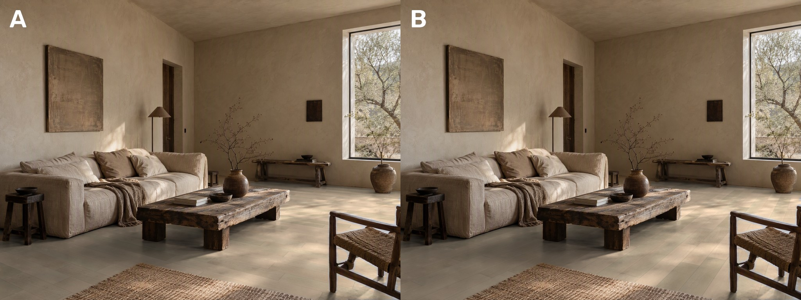
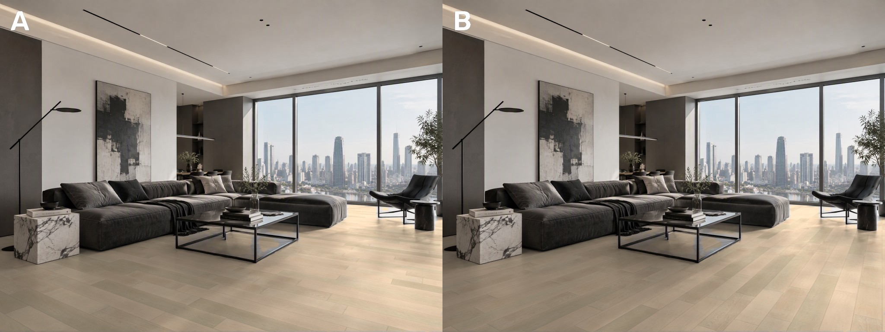
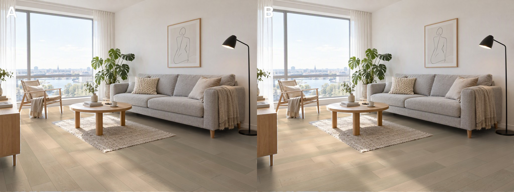

## 8. 抠图瑕疵修复（对应 assets/x1–x8 你圈出来的位置）

**原因有两个**：
1. **地板边缘一圈灰边**：家具腿、床角、柜子边上能看到原来的灰地面。SAM 3 输出的遮罩精度很低，在 2K 图上每格约 7 像素，所以边缘会偏几个像素，原来的灰地面就露出来了。深色地板（类型 3）上最明显。
2. **漏抠**：椅子框里面、玻璃茶几下面这类小块地面没被识别成地板。

**修复方法**：
1. **SAM 3 分块识别**：除了整张图识别一次，再把图切成 3×3 的块分别识别，然后合并。这样遮罩精度提高到每格约 2.7 像素，小块地面也能识别出来。
2. **已知背景抠边**：原来的地面是纯灰色的，所以在边缘每个像素上，可以把"灰地面的颜色"精确减掉，再换成新地板。物体本身的颜色完全保留，不会再出现灰边。

**修复前后对比**（左边修复前，右边修复后）：

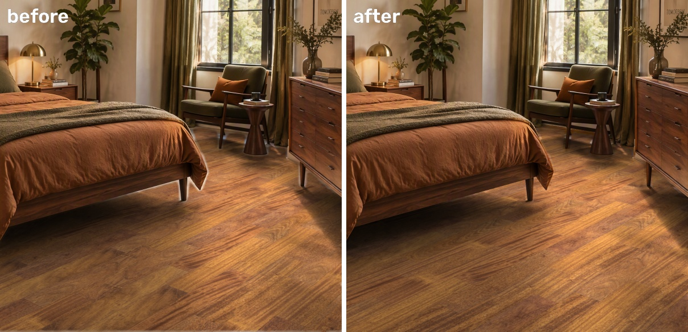
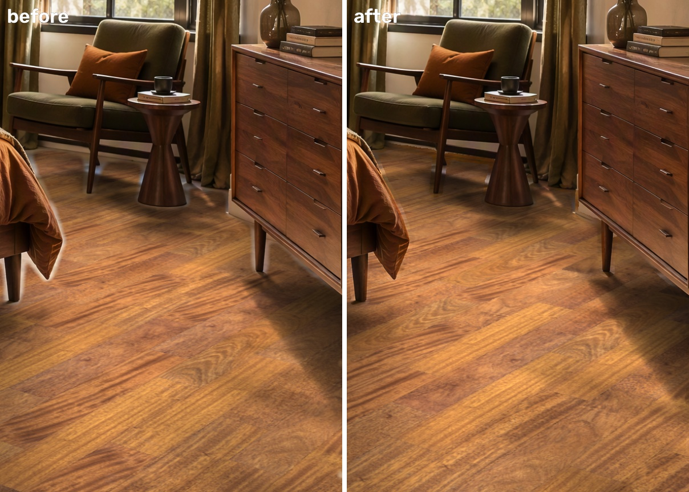
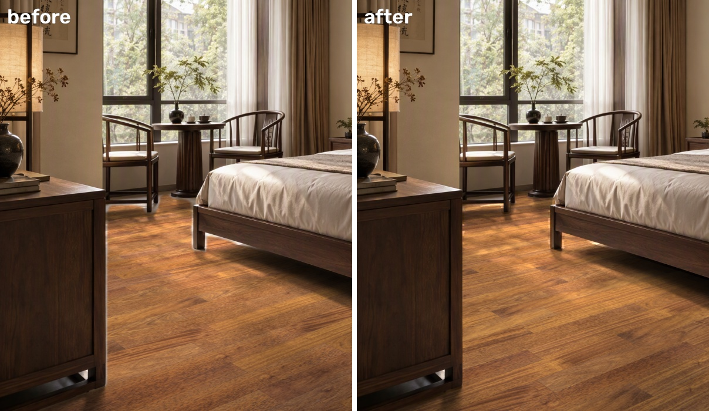
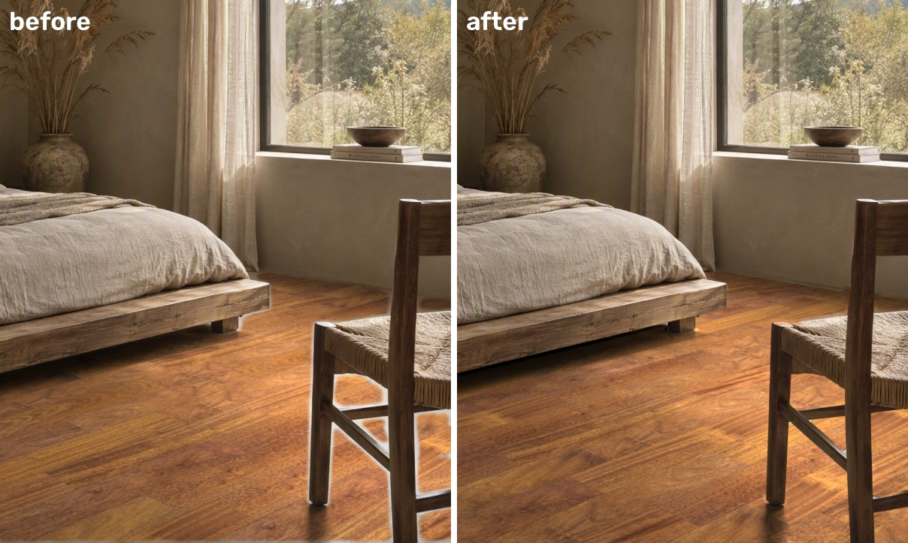
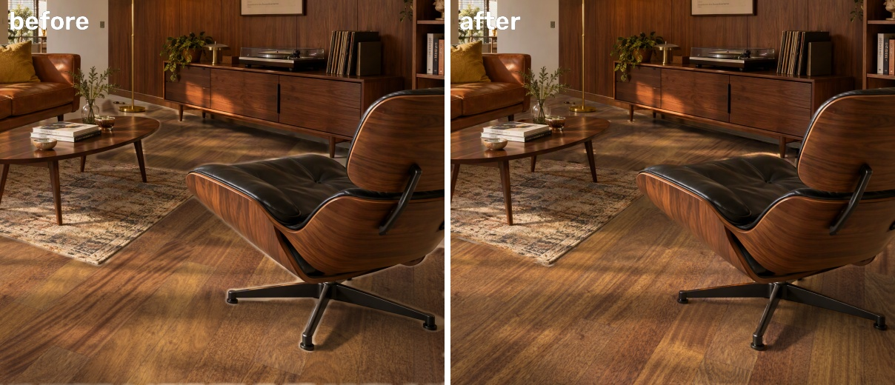
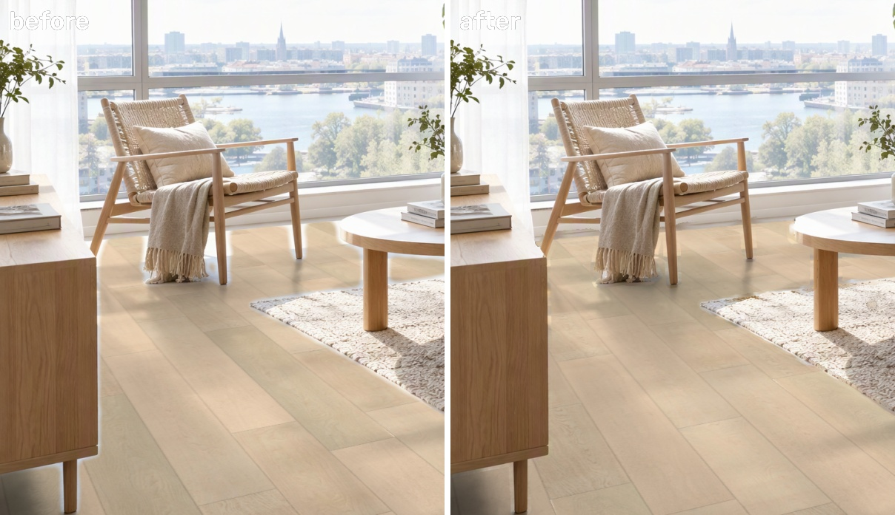
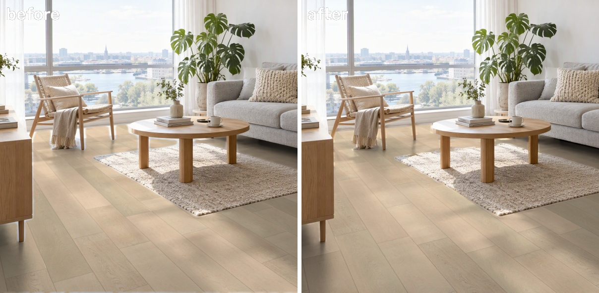
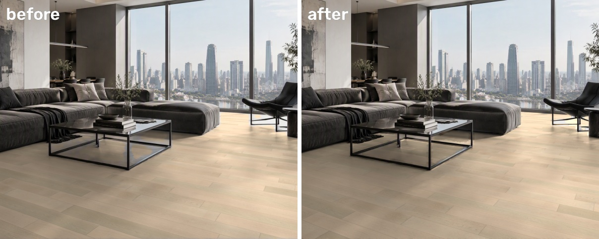

**还没完全解决：前景虚化的绿植**（第 7 张，x4/x7）：

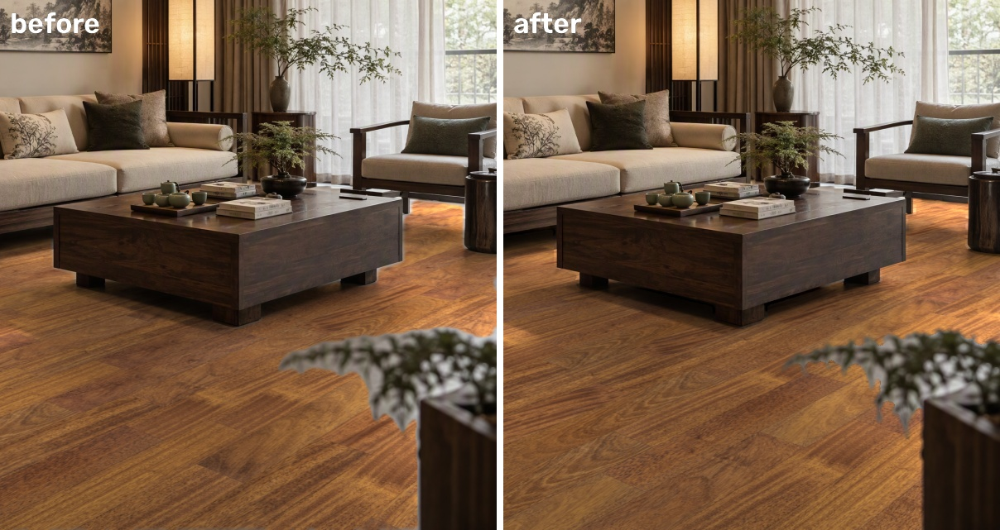

下图从上到下依次是：修复前、分块识别 + 抠边、再加专门的抠图模型（ViTMatte）：

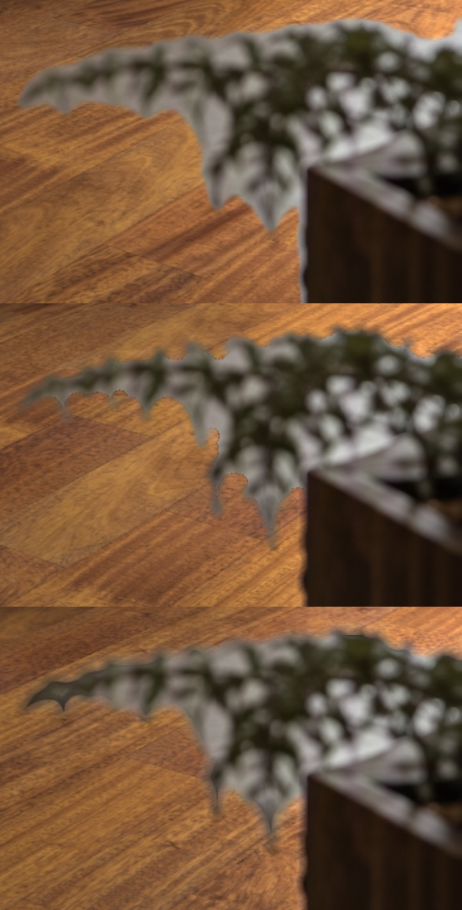

- 这盆植物是镜头前的大虚化物体，叶子的缝隙里透出的是原来的灰地面。图上已经分不清哪里是叶子、哪里是地面，所以算法改善有限。
- 我也试了专门的抠图模型（ViTMatte），植物边缘稍好一点，但在玻璃茶几和家具腿上反而产生了新的黑边，所以默认不用。
- 解决办法：
  - 生成场景时，在提示词里加一句"前景无虚化物体，全景深"。
  - 如果已经有这种图，就用工具里的画笔手动修。

**耗时**：分块识别在 4060 显卡上预计每张场景多 5–10 秒。这一步只在导入场景时做一次，之后换地板不用重复。

## 9. 测试：不用 AI 模型抠图

用普通图像算法（颜色、纹理、边缘）识别灰色地面，结果和 SAM 3 对比。共调了 3 个版本，下面是最好的一版。

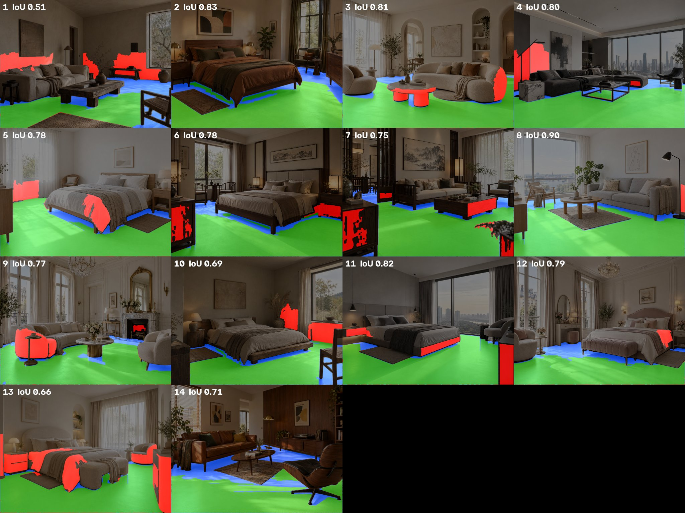

图中绿色 = 两者都认为是地面；红色 = 普通方法多抠了（墙、床品、沙发、家具）；蓝色 = 普通方法漏抠了（家具阴影、暗处地面）。

- 重合度（IoU）：中位数 0.78，最好 0.90，最差 0.51。14 张里没有一张能直接用。
- 速度：每张不到 1 秒。
- 原因：这些场景是浅灰地面配米色、灰色的墙、床品和沙发，家具下面的地面阴影又和深色木家具差不多深。光靠颜色和纹理分不清，这个问题调参数也解决不了。
- 结论：不用 AI 模型的话，每张场景都要 AI 在对话里手动描轮廓（最早第一版就是这样做的，一张约 20 分钟）。所以抠图这一步保留 SAM 3。

## 原型代码
[`code/`](code/) 里是这次验证用的原型脚本（文件路径是写死的，只用于验证）。正式工具会在这个基础上重写。
