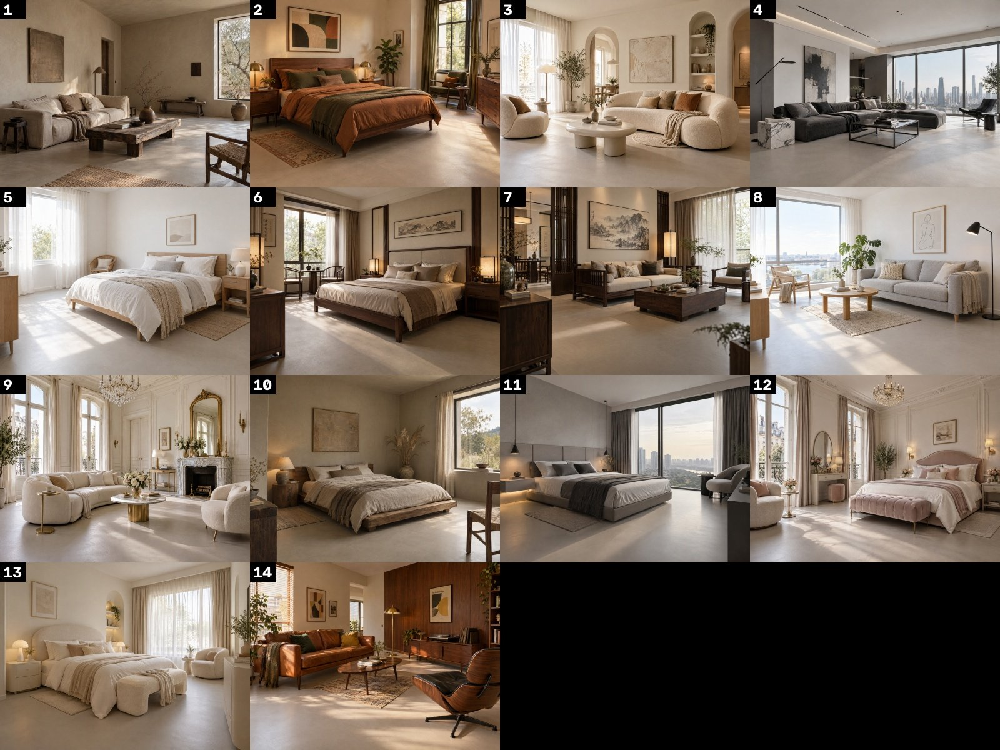
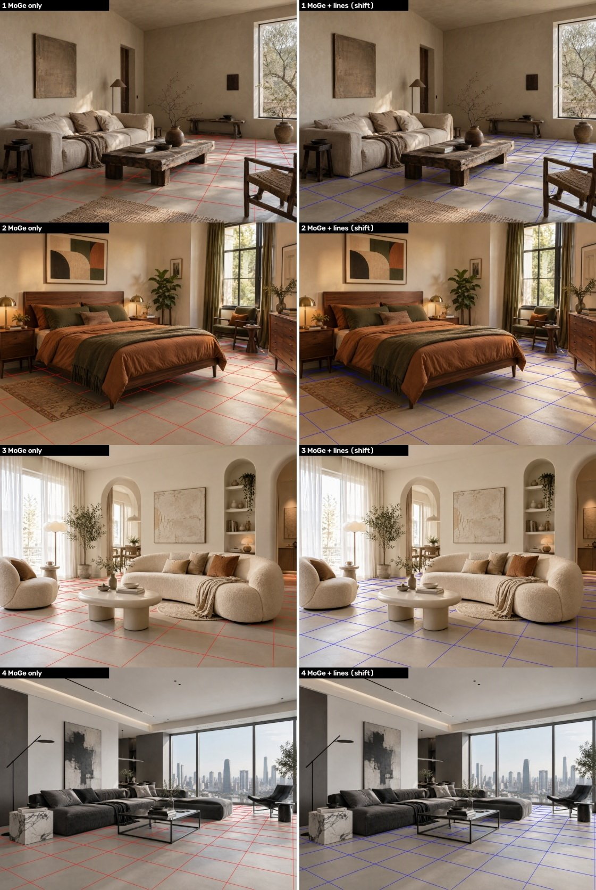
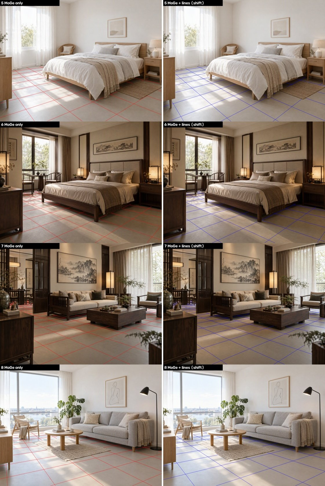
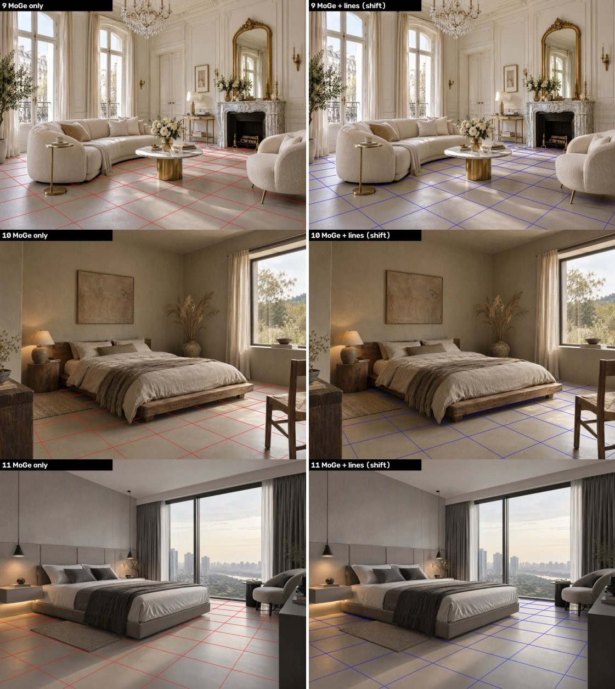
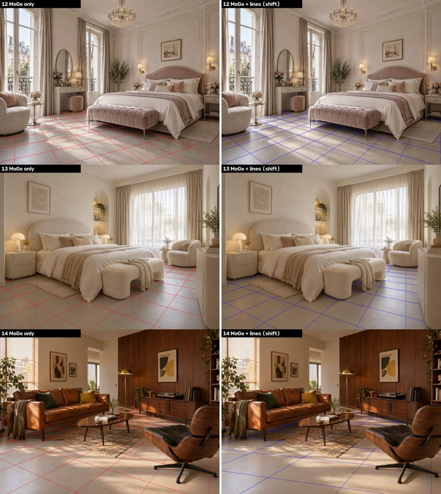

# 模型验证：阶段性结果（14 张场景）

测试环境：只有 CPU，没有显卡。模型：SAM 3（抠地面）+ MoGe-2（透视和尺寸）+ 直线校正。

## 场景总览

## 1. 自动抠图（SAM 3）

绿色 = 识别为地面（会铺上木地板）；紫色 = 地毯（保留不动）。全部是自动结果，没有手工修正。

**结论：14 张都可以直接用。** 床底、家具腿之间、地毯边缘都抠得准确。第 14 张的紫色区域包括了沙发上的毯子，但它不在地面上，不影响结果。

## 2. 透视（地面网格，每格 0.5 米）

左边红色 = 只用 MoGe；右边蓝色 = MoGe + 直线校正（移轴相机模型），**也就是工具准备采用的方案**。

判断方法：网格线应该和墙脚线、床边、柜子底边平行，越往远处格子越小，并且整体比例看着合理。

**结论**
- AI 生成的图大多是"竖线垂直、地平线偏高"，相当于建筑摄影里的移轴镜头。只用 MoGe 时会把这种画面误判成相机向下倾斜，网格和墙脚线就对不齐，第 2、4、5 张比较明显。
- 加上直线校正后，14 张的网格方向都和墙脚线基本对齐。这是目测判断，还没有做量化测量。
- **还没解决**：第 14 张估计的相机高度只有 0.61 米，比例偏大，可以看到格子明显比别的图大，需要再处理。其他场景估计在 0.8–1.2 米之间。

## 下一步
- 处理第 14 张的尺寸问题
- 用真实的地板贴图铺几张，看最终效果
