# 模型验证报告（14 张场景 × 3 种地板素材）

测试环境：只有 CPU，没有显卡。模型：SAM 3（抠地面）+ MoGe-2（透视和尺寸）+ 直线校正。
**所有结果都是全自动生成的，没有手工描点或修正。**

## 结论

| 项目 | 结果 |
|---|---|
| 自动抠地面 | 14/14 张可以直接用，床底、家具腿之间、地毯边缘都准确，地毯自动保留 |
| 透视 | 14/14 张网格和墙脚线基本对齐（目测判断，量化测量没有得到可靠结论，见第 2 节） |
| 尺寸 | 估计的相机高度在 0.87–1.20 米之间，都在合理范围内；第 14 张之前偏大的问题已修复 |
| 三种素材自动处理 | 类型 1 扫描图、类型 2 多片合拍（自动识别出 16 片并拉正）、类型 3 单片拍摄，全部跑通 |
| 铺法 | 工字拼、人字拼都已实现，只用真实的板，不镜像、不拉伸 |
| 颜色 | 色相偏差平均 ΔE 0.6–1.7（肉眼基本看不出）；亮度随场景光线变化，见第 5 节 |
| 速度（CPU） | 抠图约 25 秒，透视约 12 秒，合成：工字拼约 1.5 秒、人字拼约 4 秒。显卡上抠图和透视预计各 1–2 秒 |

> **地板尺寸是我假设的**：类型 1 宽 190mm，类型 3 宽 180mm（长约 1.32m），类型 2 人字拼宽 90mm（长约 0.6m）。请提供实际尺寸，画面里的比例会更准。

## 1. 自动抠图（SAM 3）

绿色 = 地面（会铺上木地板），紫色 = 地毯（保留不动）。

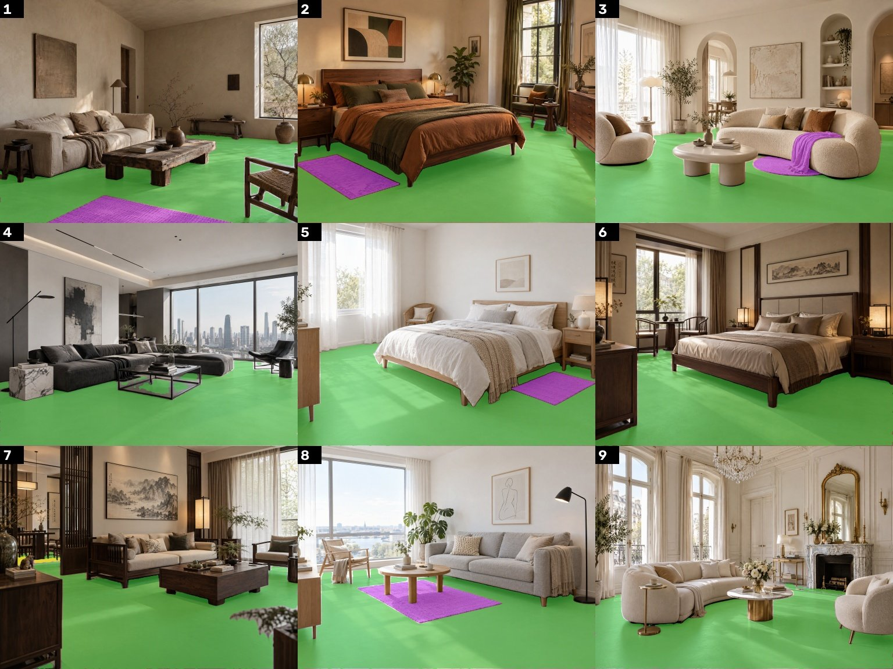
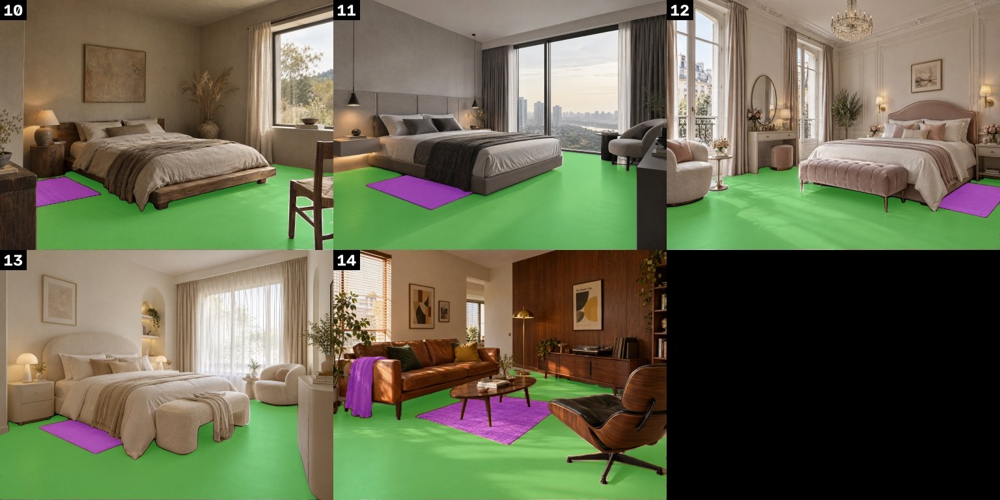

## 2. 透视（最终方案，网格每格 0.5 米）

AI 生成的图大多是"竖线垂直、地平线偏高"，相当于建筑摄影里的**移轴镜头**效果。只用 MoGe 会把这种画面误判成相机向下倾斜，网格就对不齐。最终方案改用移轴相机模型，由 MoGe 提供初始值，再用画面里的直线校正。

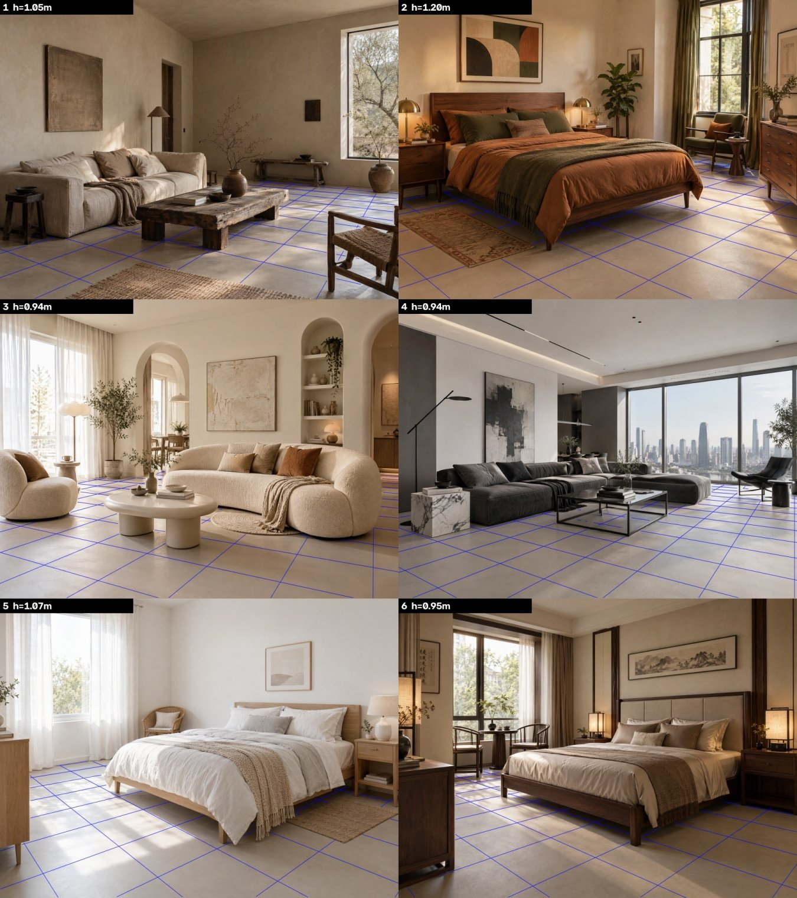
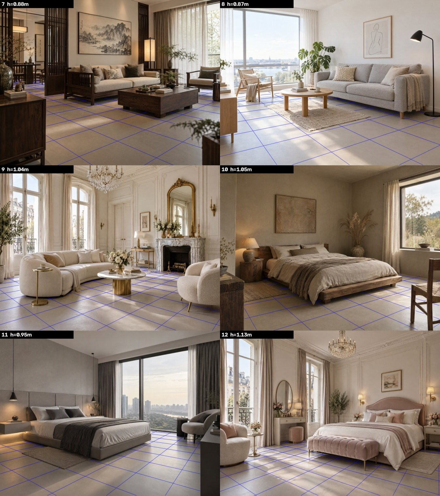
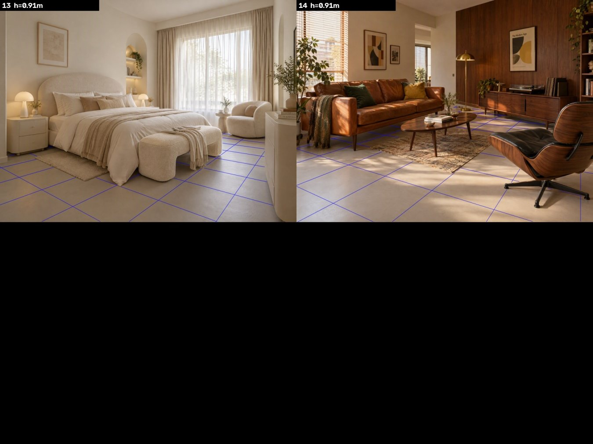

关于量化测量：我试着用"地面附近的直线是否指向灭点"来打分，但 AI 图里有很多斜放的地毯、弧形家具和不严格平行的线条，几种测法的结论互相矛盾，**所以没有得出可靠的量化数字**。目前的判断依据是逐张目测网格和墙脚线、床边、柜子底边是否平行。

## 3. 类型 2 素材的自动处理（人字拼，16 片）

左边 = 从照片里自动找出并拉正的板，右边 = 去掉单片内部的光照渐变之后。程序还自动裁掉了锁扣侧边和倒角，倾斜校正 < 0.8°，单片内渐变修正了 1.6–5.4%。按之前的约定，片与片之间的明暗差别保留。

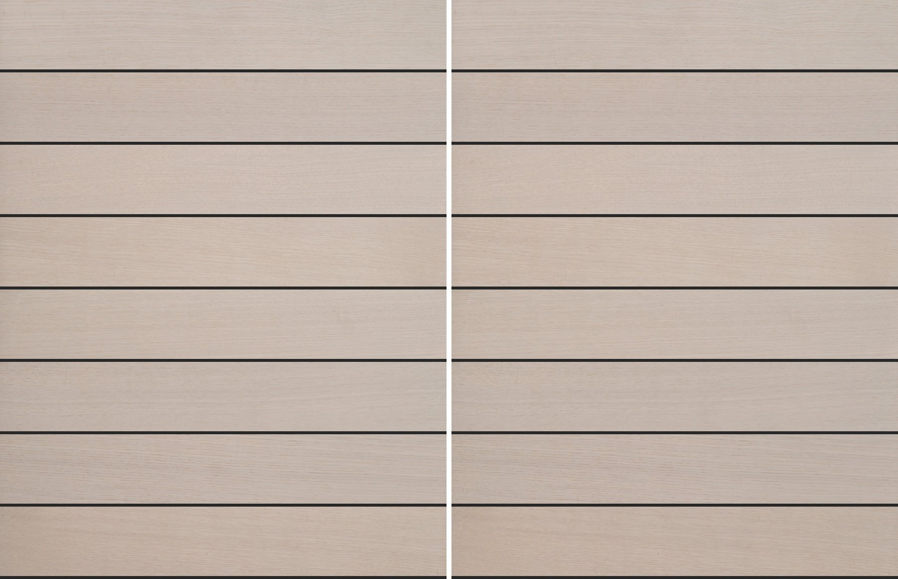

## 4. 合成效果

### 类型 1（GRIS CHAUD 扫描图）· 工字拼 · 14 张全部
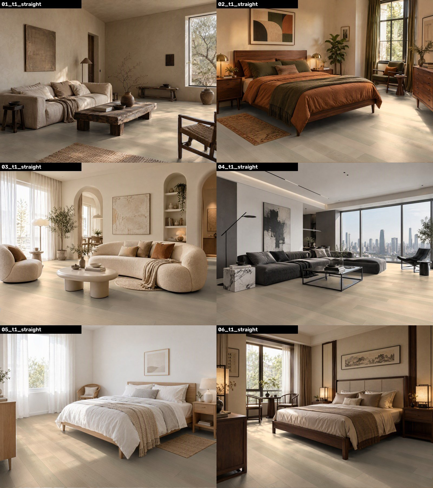
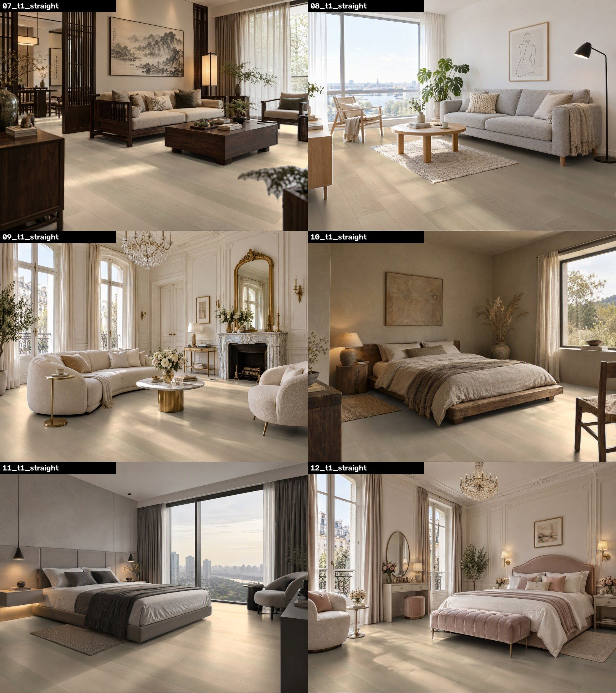
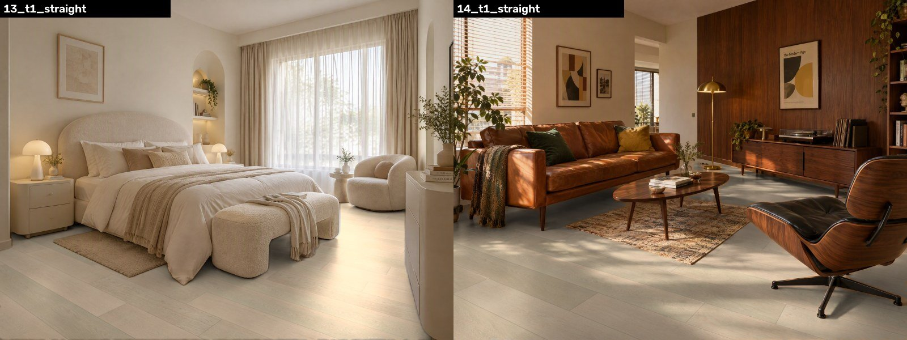

### 类型 3（单片拍摄）· 工字拼
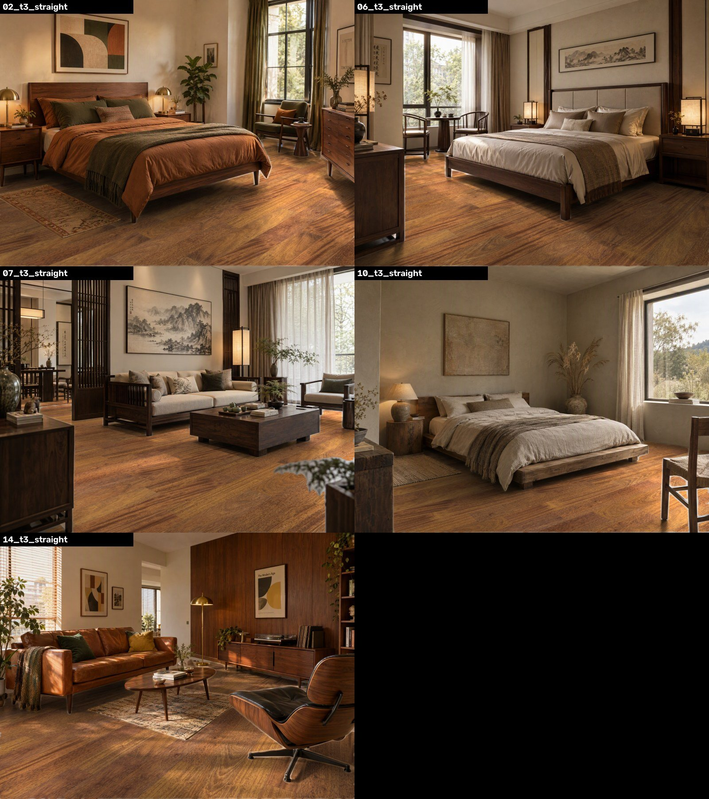

### 类型 2（多片合拍）· 人字拼
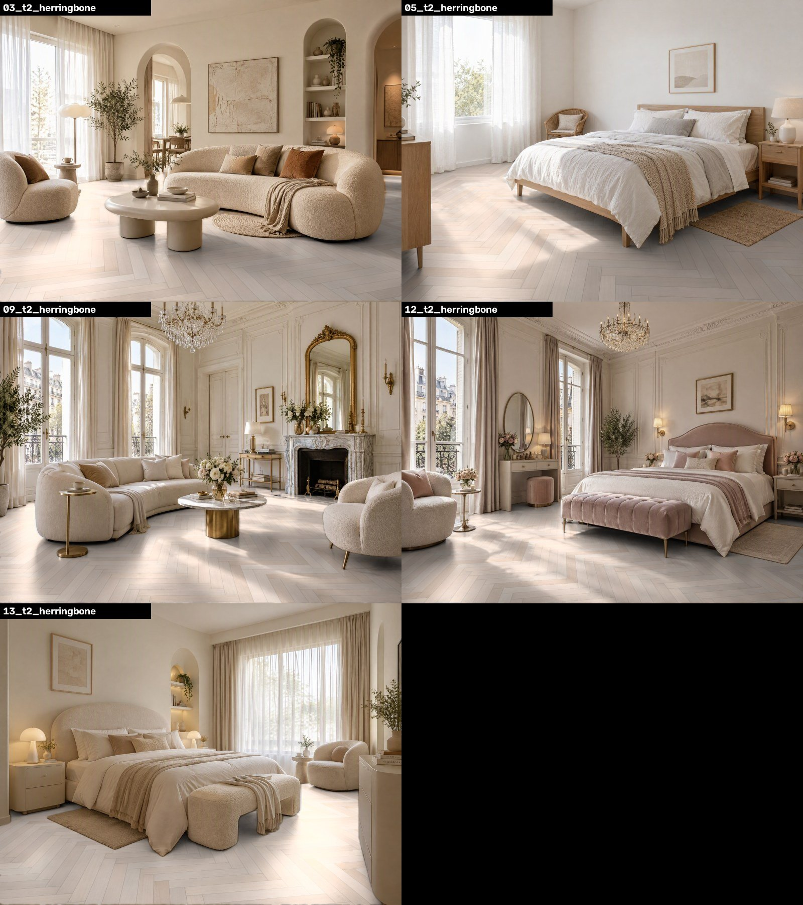

全尺寸 2048×1536 的原图在 [`renders/`](renders/) 文件夹里，建议点开看细节。

### 家具腿边缘处理
SAM 3 的边缘会带一点原来地面的颜色，工具会再按图像边缘精修一次：

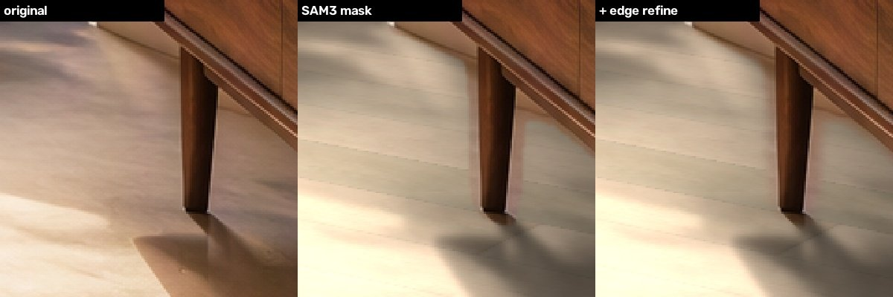

## 5. 颜色说明

- **色相（地板是什么颜色）**：和素材对比，平均偏差 ΔE 0.6–1.7，肉眼基本看不出。光影只取明暗，不取颜色，所以木地板的颜色 100% 来自素材。
- **亮度**：随场景光线变化，比素材暗 0–10 个单位。原因是曝光按"被照亮的地面"对齐素材，房间暗处和阴影本来就应该更暗。像第 1、5、6、8 张这样整体偏暗或背光的场景，平均亮度会偏低。
- **取舍**：暖色夕阳类的场景（比如第 2、14 张），真实照片里的地板会被光线染暖。工具默认**不染色**，以保证产品颜色准确；需要时可以打开"光线颜色"选项，不过实测效果很小。

## 6. 已知问题
1. 地板尺寸是假设值（见上文），需要你提供真实尺寸。
2. 类型 1 和类型 2 这两款颜色浅、木纹对比度低，在画面里纹理看起来比较淡。这是产品本身的特点，不是处理时丢失的。
3. 家具腿和薄边缘的个别地方，还能看到很细的色边。
4. 类型 3 的照片被放大和锐化过，第 5 片疑似有拼接接缝，这次照常使用了。
5. SAM 3 的官方模型需要在 Hugging Face 上申请权限。这次用的是社区镜像，文件校验值和官方完全一致。你自己安装时，也可以直接用这个镜像。

## 原型代码
[`code/`](code/) 里是这次验证用的原型脚本（文件路径是写死的，只用于验证）。正式工具会在这个基础上重写。
